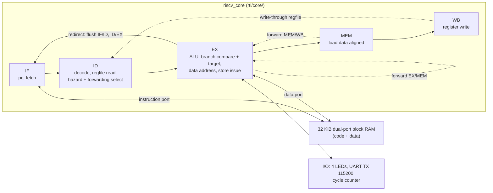

# RISC-V RV32I SoC — Formally Verified, Fault-Tolerant, with an ML Accelerator

A 5-stage in-order RV32I CPU written from scratch in SystemVerilog, **formally
verified, checked by a UVM environment against a golden model, and running on
an FPGA at 100 MHz**: a Digilent Arty A7-100T, where it runs CoreMark at
0.962 CoreMark/MHz. It can also run as **three voted copies (triple modular
redundancy)**, still at 100 MHz: in 10,000 injected single-bit faults, none
changed its output.

The project has two stages. Stage 1 is the CPU: verified, hardware-proven,
then made fault-tolerant with triple modular redundancy (TMR) and taken through
an open-source ASIC flow to GDSII. Stage 2 builds an SoC around it: an INT8
systolic-array accelerator, a descriptor-based DMA and an AXI interconnect.
**Stage 1 is done through Phase D; Phase E (TMR) is built and measured, with
its ASIC run still to come.**

Every number below is transcribed from a report committed in
[`docs/reports/`](docs/reports/), produced by a `make` target, with its
measurement conditions stated. Dashes mean not measured yet.

[](docs/img/floorplan_board_core.svg)

*The fault-tolerant core as placed and routed on the Artix-7: three copies of
the CPU (orange, green, cyan) and the voter between them (magenta), beside
the block-RAM memory (white) and the UART (red), with the critical path in
yellow. Generated from the routed design by `make floorplan`. Click to open
it, or download it and open it in a browser to zoom in to individual LUTs
and flip-flops. The single core's floorplan, from Phase D, is
[here](docs/img/vivado/phase-d/floorplan_board_core.svg).*

## At a glance

| | |
|---|---|
| **ISA** | RV32I, all 40 instructions; every exception traps (halts) |
| **Pipeline** | 5 stages, full forwarding, 1-cycle load-use stall, branches resolved in EX (static not-taken) |
| **On the board** | Arty A7-100T, **100 MHz**, timing met with +0.955 ns slack (110.6 MHz estimate); the TMR core also meets 100 MHz (+0.062 ns) |
| **CoreMark** | **0.962 CoreMark/MHz**, about **96 CoreMark** at 100 MHz, validated, with no hardware multiply |
| **IPC** | 0.691 on CoreMark (CPI 1.447), counted in RTL simulation of the same SoC; it matches the board's cycle count to 0.0013% |
| **Size** | 966 LUT, 467 FF (core alone); 1123 LUT, 435 FF, 8 BRAM (whole SoC on the board): under 2% of the chip. TMR: 3370 LUT, 1589 FF on the board |
| **Fault tolerance** | Three voted copies with feedback; voter formally proven; **10,000 random single-bit faults, 0 failures**, every detected fault corrected and the copies back in step |
| **Formal** | riscv-formal **46/46 checks**; the pipeline's hazard, forwarding, flush, reset and X-propagation properties proven by k-induction; every check shown reachable, and the consistency checks shown to fail on planted bugs |
| **Bugs formal caught that simulation missed** | **2**, both of which would have broken the ASIC (below) |
| **UVM** | **205/205** functional coverage bins (100%); ~45,000 retirements per run compared with a C golden model, 0 mismatches |
| **Simulation** | 306/306 cocotb tests, including the official `riscv-tests` suite (40/42; the 2 exclusions are explained) |
| **Interactive** | A serial bootloader: programs load over the UART in a fraction of a second, no FPGA rebuild; six interactive demos |
| **CI** | Lint, simulation and formal on every push |

## Status

| Stage | Phase | State |
|---|---|---|
| **1 — CPU** | A — Working core | **Done** |
| | B — Formal verification | **Done** |
| | C — UVM environment | **Done** |
| | D — Hardware bring-up | **Done** |
| | E — TMR + fault injection, ASIC run #1 | **TMR done and measured**; ASIC run #1 next |
| **2 — SoC** | F — Systolic array | Not started |
| | G — DMA + AXI interconnect | Not started |
| | H — Integration + DFT, ASIC run #2 | Not started |

Full scope and each phase's definition of done: [docs/buildplan.md](docs/buildplan.md).
Day-to-day state, trend tables and decisions: [docs/PROGRESS.md](docs/PROGRESS.md).

## Architecture



- **Five stages, BRAM-timed memories.** Fetch presents the next pc to the block
  RAM so RAM and pc latch on the same edge. Data memory is accessed from EX:
  the address comes from its own adder, and load data arrives in MEM and is
  registered, so no forwarding path starts at a RAM output. That change took
  the board from 50 MHz to 100 MHz.
- **Forwarding** from EX/MEM and MEM/WB into EX, with the selects decided in ID
  and registered; WB writes through the register file to ID. One stall cycle
  for a load followed directly by its use.
- **Branches and jumps resolve in EX** with static not-taken prediction:
  taken costs two cycles, not taken none.
- **Exceptions halt**: ECALL, EBREAK, illegal instructions (anything outside
  the 40 RV32I encodings), misaligned accesses and misaligned taken targets.
- **SoC** (`rtl/top/soc.sv`): the core, one 32 KiB dual-port RAM for code and
  data, LED and UART (transmit and receive) registers and a cycle counter at
  `0x1000_0000`. The RAM boots a serial bootloader (`sw/boot/`) that receives
  programs from `scripts/load.py` and runs them.
  `arty_a7_top.sv` adds the MMCM (100 MHz), the reset synchroniser and the
  pins.
- **RVFI** trace port and the formal properties live in the RTL under
  `ifdef`, compiled out of synthesis.

## Verification

Four independent layers, each catching what the others cannot.

**Formal** (`make formal`, SymbiYosys and riscv-formal, about 6 minutes;
[docs/formal-properties.md](docs/formal-properties.md)):

- **riscv-formal: 46/46 checks** by bounded model checking: all 37
  instruction checks, plus register, pc forward/backward, uniqueness, causal,
  causal memory, liveness, hang and illegal-instruction checks. Each of the
  46 has a cover run showing it is reachable, and each consistency check was
  shown to fail on a deliberately planted bug.
- **Pipeline properties proven by k-induction**, which covers every reachable
  state, not just a bounded depth: x0 is always zero; stall correctness
  (S1–S4); forwarding correctness (F1/F2, L1); reset commits nothing (X1);
  branch-flush correctness (B1/B2); no register-file structural hazard (SH1);
  nothing left over from power-up ever reaches committed state as X (XP,
  induction; XT, bounded with an undefined register file).
- **Two bugs found that simulation missed:**
  1. **Yosys misreads a size cast.** `~XLEN'(2'b11)` was parsed with the `~`
     applied to the width, so jump targets were never masked. Verilator and
     Vivado read it correctly, so simulation and the FPGA were fine, but Yosys
     is also the front end of the ASIC flow. Without this check, the chip's
     jumps would have landed on unaligned addresses.
  2. **Reset could write garbage to data memory.** The pipeline registers hold
     their power-up values during the reset cycle, and nothing gated the store
     port. Verilator and the FPGA both power flops up to zero, so it never
     showed; on an ASIC, flops power up random. Now proven impossible (X1).

**UVM** (`make uvm`, Vivado XSim): random programs from a constrained
generator, a reactive memory responder, and a scoreboard that steps a C golden
model (via DPI-C) on every RVFI retirement. **205/205 coverage bins** from
[docs/coverage-plan.md](docs/coverage-plan.md), about 45,000 retirements per
run, 0 mismatches. Three planted RTL bugs (wrong forwarding priority, LBU
sign-extending, a missing load-use stall) are each caught.

**Simulation** (`make sim`, cocotb on Verilator): **306/306 tests**. Unit
tests for every module; random programs with every retirement checked against
a Python golden model; the official **`riscv-tests` rv32ui suite, 40 of 42**
(`fence_i` needs the Zifencei extension; `ma_data` expects misaligned
accesses to work, and this core traps them); the first-light firmware and one
CoreMark iteration on the whole SoC, CRCs checked; the bootloader receiving a
program bit by bit on the RX pin; and each of the six demos below, its output
checked against an independent Python model. The core's tests and the SoC's
first-light, CoreMark and bootloader tests run again on the TMR core, which
must also report zero mismatches, and 1,000 injected faults must change
nothing.

**On the hardware**: an Integrated Logic Analyzer on the pipeline registers,
captured from the running chip and checked by script (below).

## Fault tolerance (TMR)

Three copies of the core run in lockstep, and a 2-of-3 voter
([`rtl/tmr/`](rtl/tmr/)) decides everything that leaves them: the fetch
address, every memory access, every register write and the halt. The voted
values also go **back into all three copies** (their pc, halt flags and
register files), so a copy that a fault knocks off course is outvoted on the
cycle it diverges and then pulled back into step. A mismatch counter, readable
by software at `0x1000_0014`, counts disagreements.

- **The voter is formally proven** for every input: any two agreeing inputs
  produce that output, and the mismatch and which-copy flags are exact.
- **Three copies survive synthesis**: `DONT_TOUCH` and `KEEP_HIERARCHY` stop
  Vivado merging them, and the build fails if any copy is missing (1601
  cells each, [`summary_ooc_tmr.txt`](docs/reports/summary_ooc_tmr.txt)).
- **Fault injection** (`make faults`): 10,000 trials, each a fresh random
  program with one random bit flipped in one copy, in any pipeline register
  or the register file, at a random cycle, judged against the golden model
  ([`tmr_faults.txt`](docs/reports/tmr_faults.txt)):

| 10,000 single-bit faults | Count | |
|---|---|---|
| Output wrong (failure) | **0** | |
| Detected (copies disagreed) | 1,275 | all corrected; all three copies identical again afterwards |
| Masked (the bit was never used) | 8,725 | 5,777 of them still sitting in registers the programs never touch |
| Disagreement length | median 1 cycle | 90th percentile 4, max 30 |

The latent ones are the honest limit of voting: a flipped bit in a register
the program never writes again stays in that copy, outvoted whenever it is
read, until software rewrites the register.

What it costs, same RTL, same conditions:

| | Single core | TMR | |
|---|---|---|---|
| Board LUT / FF | 1123 / 435 | 3370 / 1589 | 3.0x / 3.7x |
| Board Fmax (100 MHz target) | 110.6 MHz | 100.6 MHz | −9.0% |
| Core alone, out of context | 966 LUT, 120.4 MHz | 3658 LUT, 101.3 MHz | 3.8x, −15.9% |

## On the board

[](docs/img/fpgafirstlight.jpg)

**First light**: a C program compiled with GCC, printing over the UART and
counting on the LEDs.

**CoreMark**, 2000 iterations at 100 MHz, from the board's UART
([coremark_board.txt](docs/reports/coremark_board.txt)):

```
CoreMark on rv32i, 2000 iterations
2K performance run parameters for coremark.
CoreMark Size    : 666
Total ticks      : 2077692270
Total time (secs): 20
Iterations/Sec   : 100
Iterations       : 2000
Compiler version : GCC16.1.0
Compiler flags   : -O2 -march=rv32i -mabi=ilp32
Memory location  : STATIC
seedcrc          : 0xe9f5
[0]crclist       : 0xe714
[0]crcmatrix     : 0x1fd7
[0]crcstate      : 0x8e3a
[0]crcfinal      : 0x4983
Correct operation validated. See README.md for run and reporting rules.
CoreMark/MHz: 0.962
```

RV32I has no multiply instruction, so every multiply and divide in CoreMark
is a software routine. Ticks are core cycles from the SoC's cycle counter.

**Live on the chip** (`make impl ILA=1`, `make gui VIEW=ila`): the pipeline
registers captured while CoreMark runs, triggered as `core_state_transition`
enters EX. Rows top to bottom: the pc in IF/ID, ID/EX, EX/MEM and MEM/WB, then
the instruction in ID/EX. Capture:
[`ila_coremark.csv`](docs/reports/ila_coremark.csv).


| Sample | What the pipeline does |
|---|---|
| 61 | `jal` (`c55ff0ef`) into `core_state_transition` is in EX |
| 62–63 | Jump taken: IF/ID flushed (pc `0`), a NOP bubble (`00000013`) moves down |
| 64 | Trigger: the function's first instruction, `lw a5` at `21dc`, enters EX |
| 65–66 | Load-use stall: `lbu` needs `a5` from the load just ahead, and holds a cycle |
| 67–68 | And again: `beqz` needs the byte `lbu` loaded |
| 69–72 | One instruction per cycle |


The return: `ret` (`00008067`) at sample 134 flushes, and sample 137 is back in
`core_bench_state` at `258c`, the instruction after the call. Samples 140–143
are the counterpart to the stall above: `lw a5`, an unrelated `lbu`, then
`addi a5` and `sw a5` use the results with no stall, because one instruction
sits between the load and its use and forwarding covers it. Over this
1024-cycle window, 881 instructions retire (IPC 0.86 here; CoreMark overall is
0.691).

## Interactive demos

https://github.com/user-attachments/assets/613c0f44-95a8-44bf-8c4c-f08adaeafa4e

*On the board, in PuTTY: the bootloader, then all six demos from the menu.*

The board boots a serial bootloader, so any program loads in a fraction of
a second without rebuilding the FPGA:

```
make apps
scripts/load.py sw/build/apps/demo.bin --term
```

A menu of six demos ([`sw/demo/`](sw/demo/)), each interactive. Every one was
checked in simulation against an independent Python model before it ran on
the board. Board results, from
[`demo_board.txt`](docs/reports/demo_board.txt):

| Demo | What it shows | On the board at 100 MHz |
|---|---|---|
| **System info** | A RAM test, and the pipeline's costs **measured live** by timing blocks of instructions with the cycle counter | 1 cycle per ALU op; +1 per load used by the next instruction; 0 when one instruction sits between (forwarding); +2 per taken branch or jump; 0 for a branch not taken. Exactly as designed |
| **Mandelbrot** | Pan and zoom; the same frame in integer fixed point and in **software floating point** (no FPU) | 128 ms fixed point, 491 ms float: **3.8x**. Both pictures match a bit-exact model, IEEE single precision included |
| **Digits of π** | A spigot algorithm, streamed digit by digit; every step divides, in software | 750 digits in 4.95 s, all correct |
| **Game of Life** | Animated; pause, step, random or glider gun; the LEDs count generations | 81,581 cycles per generation |
| **Tower of Hanoi** | Animated, adjustable speed | 2ⁿ − 1 moves |
| **Prime sieve** | Up to 163,840, then tests any number you type | π(10⁵) = 9592; the full sieve in 16.0 ms |

## In Vivado

The CoreMark build of 2026-10-17: 100 MHz, WNS +1.550 ns, before the UART
receiver (+38 LUT, +37 FF) joined (`make gui`, `make gui VIEW=rtl`). The
floorplan at the top is from the same build. A new set follows each milestone; these
are from Phase D, in [`docs/img/vivado/phase-d/`](docs/img/vivado/phase-d/).
The [whole-die floorplan](docs/img/vivado/phase-d/floorplan_board.svg) shows the SoC in one
of the chip's eight clock regions.

| | |
|---|---|
|  Device view, coloured by module |  Zoomed to single slices, with routing |
|  The worst setup path on the die |  The same path: forwarding select → branch comparator (CARRY4 chain) → redirect → pc mux → block RAM address |
|  The core as elaborated RTL |  The ALU, opened up |
|  Timing: met at 100 MHz, WNS +1.550 ns, WHS +0.110 ns |  Utilization by module |
|  Power: 0.26 W, Vivado's **vectorless estimate**, not a measurement; the MMCM is 65% of it | |

## Results

Conditions travel with every number: an out-of-context Fmax models no clock
skew and is not the same quantity as a board-level one, so they are separate
rows. The per-slice trends (what each feature cost in LUTs and MHz) are in
[docs/PROGRESS.md](docs/PROGRESS.md).

**Stage 1 — CPU.** Part `xc7a100tcsg324-1`, Vivado 2025.2.

| Metric | Value | Report |
|---|---|---|
| Fmax, core alone, out-of-context, post-route (10.000 ns constraint) | 120.4 MHz | [summary_ooc.txt](docs/reports/summary_ooc.txt) |
| Fmax, on the board (core + RAM + I/O, in context, MMCM clock) | runs at **100 MHz**, WNS +0.955 ns, 110.6 MHz estimate | [summary_board.txt](docs/reports/summary_board.txt) |
| LUT / FF / BRAM / DSP, core alone, out-of-context | 966 / 467 / 0 / 0 | [summary_ooc.txt](docs/reports/summary_ooc.txt) |
| LUT / FF / BRAM / DSP, whole SoC on the board | 1123 / 435 / 8 / 0 | [summary_board.txt](docs/reports/summary_board.txt) |
| CoreMark/MHz, on the board, 100 MHz, 2000 iterations, validated | **0.962** (about 96 CoreMark); RV32I without M | [coremark_board.txt](docs/reports/coremark_board.txt) |
| IPC / CPI, CoreMark timed region, RTL simulation of the same SoC | 0.691 / 1.447 | [coremark_sim.txt](docs/reports/coremark_sim.txt) |
| Formal | riscv-formal 46/46 (BMC); pipeline properties by k-induction (k = 1 to 7), XT by BMC to depth 10 | [formal-properties.md](docs/formal-properties.md) |
| Bugs formal caught that simulation missed | 2 | [formal-properties.md](docs/formal-properties.md) |
| Functional coverage (UVM) | 205/205 bins, 100% | [coverage-plan.md](docs/coverage-plan.md) |
| TMR: faults injected / failures | 10,000 / **0**; 1,275 detected, all corrected and recovered | [tmr_faults.txt](docs/reports/tmr_faults.txt) |
| TMR: area overhead / Fmax penalty (board) | 3.0x LUT, 3.7x FF / −9.0% (still meets 100 MHz) | [summary_board_tmr.txt](docs/reports/summary_board_tmr.txt) |

**Stage 2 — SoC.** Not started.

| Metric | Value |
|---|---|
| GOPS (INT8) at achieved Fmax | — |
| **Measured** PE utilization | — |
| Speedup vs. software matmul | — |
| DSP slices used vs. LUT-fabric MACs | — |
| AXI outstanding depth / measured throughput | — |
| SVA properties proven on AXI interfaces | — |

**ASIC flow (LibreLane + Sky130).** Two runs: the bare core closing Phase E, the full
SoC in Phase H. The delta between them is the result.

| Metric | Run 1 (bare core) | Run 2 (full SoC) |
|---|---|---|
| Die area, cell count, utilization | — | — |
| Post-layout Fmax | — | — |
| Power estimate | — | — |
| DRC / LVS clean | — | — |
| Scan chains: count, coverage, area overhead | — | — |

## Limitations

Stated plainly, because they are real:

- **RV32I only.** No multiply/divide (M), no floating point, no compressed
  instructions, no CSRs (the cycle counter is memory-mapped), no interrupts or
  privilege modes. Every exception halts the core rather than trapping to a
  handler. These are scope choices ([docs/buildplan.md](docs/buildplan.md) §7),
  and CoreMark is reported with that in mind.
- **32 KiB of memory**, code and data together, in block RAM. No caches and no
  DDR. Programs get 28 KiB after the bootloader.
- **The UART receiver buffers one byte.** Typing is fine; text pasted while a
  program is busy printing can lose characters.
- **Static not-taken branches**: every taken branch or jump costs two
  cycles. Branch prediction is deferred until after TMR, and then only with a
  measured IPC gain.
- **The out-of-context Fmax is optimistic**: it leaves the core's ports
  untimed. The board-level number is the one that counts, and it is the one
  quoted first.
- **Power is an estimate.** Vivado's vectorless analysis, not a measurement.
- **TMR guards the core, not the memory.** The RAM, the I/O and the voter
  itself are single; protecting memory (ECC) is out of scope. Register-file
  faults in unused registers stay latent until rewritten (see Fault
  tolerance).

## Build and reproduce

Requires Verilator ≥ 5.036 and **cocotb ≥ 2.1.0** (2.0.1 segfaults reading a
port once a register-file-sized array exists), a venv at `~/cocotb-env`, the
RISC-V GNU toolchain, and OSS CAD Suite for formal. Vivado 2025.2 (free ML
Standard edition) for synthesis, UVM and the board:
[docs/vivado-setup.md](docs/vivado-setup.md). Vivado runs in batch from Tcl
scripts in `syn/`; no project directory is ever committed.

| Target | Does |
|---|---|
| `make lint` | Verilator lint of `rtl/`, zero warnings |
| `make sim` | cocotb regression on Verilator, 306 tests |
| `make formal` | SymbiYosys properties and riscv-formal, checks and covers |
| `make uvm` | UVM regression in XSim (`SEED`, `PROGRAMS`, `COV_MIN`) |
| `make model-test` | The C golden model alone on rv32ui |
| `make synth` | Out-of-context synth **and** place & route of the core and of the TMR core, reports to `docs/reports/` |
| `make faults` | The TMR fault-injection campaign (10,000 trials) |
| `make fw` / `make bench` | First-light firmware / CoreMark images |
| `make boot` / `make apps` | The serial bootloader (the default bitstream image) / programs and the demo reel for it |
| `scripts/load.py <bin> [--term]` | Send a program to the board and, with `--term`, talk to it |
| `make impl` | Board-level place & route and bitstream (`FW_IMAGE=`, `ILA=1`), reports to `docs/reports/` |
| `make prog` | Program the Arty (from WSL via usbipd, or prints the Windows steps) |
| `make ila` | Capture the pipeline registers from the running board and check them |
| `make gui` | Open the routed design in the Vivado GUI (`VIEW=rtl`: RTL schematic; `VIEW=ila`: live waveforms) |
| `make floorplan` | Draw the routed design as zoomable SVGs in `docs/img/` |
| `make asic` | LibreLane RTL-to-GDSII (Phase E, then H; prints what it is waiting on) |

`make synth` routes rather than stopping at synthesis: post-synthesis timing is
an estimate, post-route timing is measured. CI runs lint, simulation and
formal; Vivado is too large for a hosted runner, so synthesis runs locally and
its reports are committed with the RTL that produced them.

## Repository layout

| Path | Contents |
|---|---|
| `rtl/core/` | The pipeline: `riscv_core`, decoder, ALU, branch unit, hazard unit, load/store alignment, register file |
| `rtl/tmr/` | The 2-of-3 voter and the triplicated core |
| `rtl/periph/` | UART transmitter and receiver |
| `rtl/top/` | The SoC (`soc.sv`), its RAM, and the Arty A7 top (clocking, reset, pins, optional ILA) |
| `tb/cocotb/` | Python testbenches and the Python golden model |
| `tb/uvm/` | UVM environment (XSim), DPI-C bridge to the C model |
| `tb/formal/` | SymbiYosys jobs, harnesses, riscv-formal config (submodule) |
| `sw/model/` | C golden model (ISS) |
| `sw/boot/`, `sw/app/`, `sw/lib/` | The serial bootloader; startup and linker script for the programs it loads; their console library |
| `sw/demo/`, `sw/apps/` | The demo reel; small programs (e.g. `echo`) |
| `sw/firstlight/`, `sw/coremark-port/` | Bare-metal firmware and the CoreMark port (CoreMark itself is a submodule) |
| `sw/riscv-tests-env/` | Our environment for the official `riscv-tests` (the suite is a submodule, `sw/riscv-tests/`) |
| `syn/` | Vivado Tcl: OOC synth, board impl, ILA capture, GUI views, floorplan export |
| `constr/` | Arty A7 pin constraints |
| `scripts/` | Build automation, the ILA checker, the floorplan renderer |
| `docs/` | Build plan, progress log, formal and coverage plans, committed reports, images |

## Roadmap

- **Phase E — the rest.** A live fault injector on the board (flip a bit
  in one copy from software and watch the counter), then the first ASIC
  run: the core through LibreLane on Sky130 to GDSII.
- **Stage 2 — the SoC.** An INT8 systolic array (measured GOPS and PE
  utilisation, speedup over software matmul), a descriptor-based DMA, an AXI
  interconnect with formally proven interfaces, scan insertion, and a second
  ASIC run of the whole SoC.
- **After everything else: Doom.** Once Stage 2 ships, build what the SoC lacks
  to play Doom on the Arty: DDR3 with a cache, the game data from flash, a VGA
  framebuffer, and the M extension, measured in frames per second.
